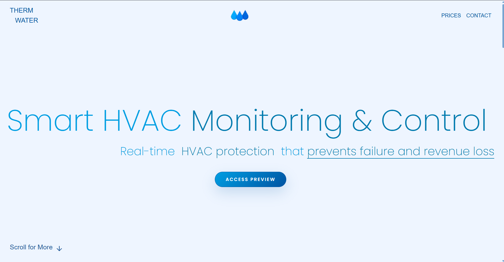

# ThermWater — Plataforma Web & Painel Administrativo (HVAC)
🔗 **Demo em produção:** [therm-water-sms.vercel.app](https://therm-water-sms.vercel.app)
> 
---
## 🎯 Problema Resolvido
Empresas do setor de sistemas de aquecimento (HVAC) frequentemente operam com sites desatualizados e controles manuais de cadastros, assinaturas e catálogo de produtos. O **ThermWater** resolve esse gargalo combinando:
- **Rebranding e interface moderna *mobile-first*** focada em clareza comercial e experiência fluida em dispositivos móveis e desktop.
- **Painel administrativo (CRUD)** centralizado para cadastro, atualização e controle de assinaturas, clientes e produtos.
---
## 🛠️ Stack Utilizada
- **Framework & Linguagem:** Next.js 16 (App Router), React 19, TypeScript
- **Estilização:** Tailwind CSS 4
- **Interação & UX:** GSAP (animações), Lenis (scroll suave), NProgress (feedback de navegação)
- **Qualidade & Deploy:** ESLint, Vercel
- **Metodologia:** Desenvolvimento colaborativo seguindo práticas ágeis (Scrum)
---
## ✨ Principais Funcionalidades
- Interface 100% responsiva (*mobile-first*) com identidade visual modernizada
- Transições e micro-interações fluidas com GSAP e Lenis
- Painel administrativo com operações CRUD para assinaturas, cadastros e produtos
- Arquitetura organizada em Next.js App Router (`app/`) para fácil manutenção e escalabilidade
---
## ▶️ Como Rodar Localmente
```bash
# 1. Clone o repositório
git clone https://github.com/arthuur01/therm-water-sms.git
cd therm-water-sms
# 2. Instale as dependências
npm install
# 3. Inicie o servidor de desenvolvimento
npm run dev
```
Acesse [http://localhost:3000](http://localhost:3000) no navegador.
---
## 👤 Autor
**Arthur Miguel Vieira Mapa** — [LinkedIn](https://linkedin.com/in/arthur-miguel-mapa) | [GitHub](https://github.com/arthuur01)
